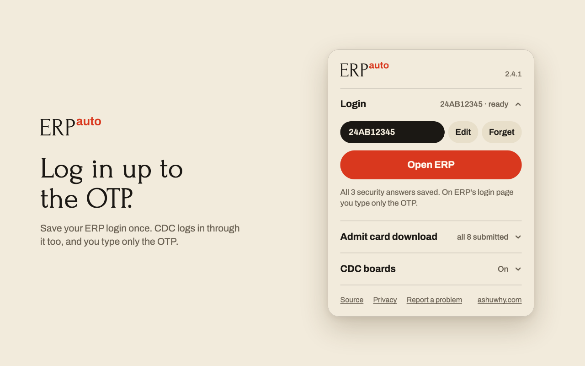
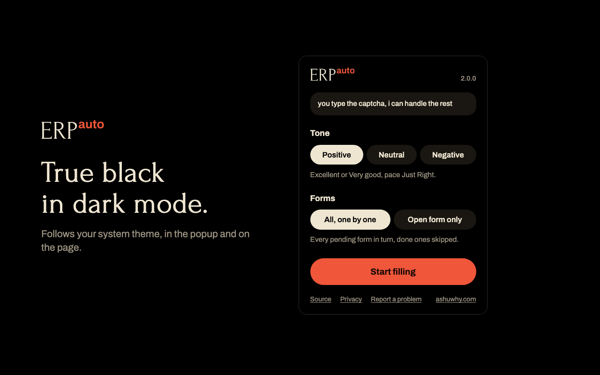

  <picture>
    <source media="(prefers-color-scheme: dark)" srcset="brand/kit/wordmark-dark.svg">
    
  </picture>

Fills your IIT Kharagpur ERP and CDC login up to the OTP and your feedback forms, and sorts CDC's company and notice boards.

  
  &nbsp;
  <a href="https://addons.mozilla.org/en-US/firefox/addon/autoerp/"><picture><source media="(prefers-color-scheme: dark)" srcset="brand/readme/add-firefox-dark.svg"></picture></a>

  <a href="https://github.com/ashuwhy/AutoERP/releases"><picture><source media="(prefers-color-scheme: dark)" srcset="https://autoerp-downloads.ashu-inc.workers.dev/?theme=dark"></picture></a>

## Install

**Chrome, Edge, Brave, Arc**

1. Download `autoerp-chrome.zip` with the button above.
2. Open `chrome://extensions` and turn on **Developer mode**, top right.
3. Drag the zip onto that page. No need to unzip it.

If your browser won't take the zip, unzip it and pick the `autoerp-chrome` folder with **Load unpacked**. To update, remove the old AutoERP before you drop in the new zip, or you'll have two. Removing it deletes your saved login too, so set that up again after.

**Firefox**

AutoERP is on [Firefox Add-ons](https://addons.mozilla.org/en-US/firefox/addon/autoerp/). Open it, click **Add to Firefox**, and Firefox keeps it updated from then on.

## Use

**Login**

1. Click the AutoERP icon and open **Login**. Type your roll number and ERP password, press **Continue**, answer the three security questions ERP sends back and press **Save login**.
2. Open ERP or CDC (or press **Open ERP**). AutoERP fills the roll number, password and security answer. Press **Send OTP** on its card and ERP mails you the OTP.
3. Type the OTP and press `Enter`.

AutoERP never asks for an OTP by itself, so a tab loading in the background, a restored session or the login page after you sign out mails you nothing. If ERP asks you for a new password after the OTP, AutoERP fills the current one and saves the new one once ERP accepts it.

Once you log out, AutoERP leaves the login page alone until you reload it. Your login stays on your computer, unencrypted, and goes only to ERP's login and password-change pages.

**Feedback forms**

1. Log in to ERP.
2. Click the AutoERP icon, open **Admit card download**, pick a tone and press **Start filling**. If **Academic > Feedback > Feedback Form** isn't open, AutoERP clicks its way there first.
3. Type each captcha and press `Enter`. The next form opens by itself, and the ones you already submitted are skipped.

The tone sets the ratings, pace, workload and the written answers, and every written answer stays inside ERP's 10-50 word limit. **Open form only** fills just the form in front of you, if you want a different tone for one teacher.

Once ERP has every form, the fold shows **Download admit card** instead.

**CDC boards**

Open CDC's company page or notice board in ERP and AutoERP puts its own board above ERP's grid, which stays where it was.

- Companies: **Open now**, **Opens soon** and **Closed** tabs, open roles by deadline with a countdown, the CTC as "18.15 L", and ERP's own verdict for each role: Applied, Can apply, Not eligible (with ERP's reason) or Check on ERP. Roles ERP says you aren't eligible for are hidden behind a count you can click. Roles added since your last visit say NEW.
- Notices: the full text of every notice, search, category and Placement/Internship filters, NEW since your last visit, and **My companies** for notices about the companies you applied to.

The company board keeps up while the page stays open: when you close ERP's role dialog, from its grid or from **Role page**, AutoERP asks ERP about that role again, so Apply or Cancel apply shows at once, and a role moves tab when its deadline passes or it opens. **Show boards** in the popup's **CDC boards** fold turns both boards off; **Forget CDC data** beside it deletes what they stored.

**Role page** and **Attachment** open ERP's own role page and file, as ERP's grid does. AutoERP never applies, cancels or picks a CV for you; you still press Apply on ERP. Desktop Chrome and Firefox only.

AutoERP does not solve the captcha or read your mail for the OTP, only talks to `erp.iitkgp.ac.in`, and sends nothing to me or anyone else. See [PRIVACY.md](./PRIVACY.md).

## More

- Logo kit and store art are in [brand](./brand). [brand/mark.py](./brand/mark.py) draws every icon, the wordmark and the buttons above, from [Forum](https://fonts.google.com/specimen/Forum) and [Archivo](https://github.com/Omnibus-Type/Archivo) (both OFL).
- Bugs go in [issues](https://github.com/ashuwhy/AutoERP/issues). Me: [ashuwhy.com](https://ashuwhy.com).

MIT licensed, see [LICENSE](./LICENSE). The AutoERP name and logo aren't part of that grant, so a fork should ship under its own.
